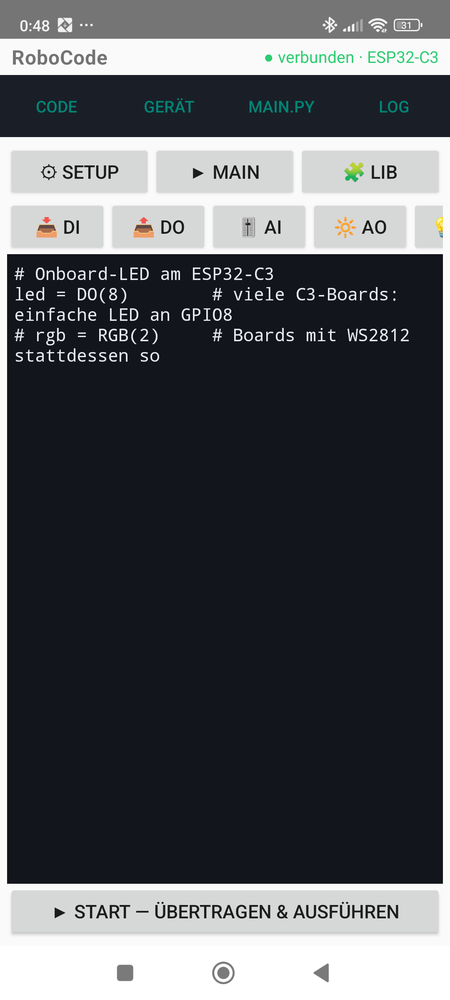
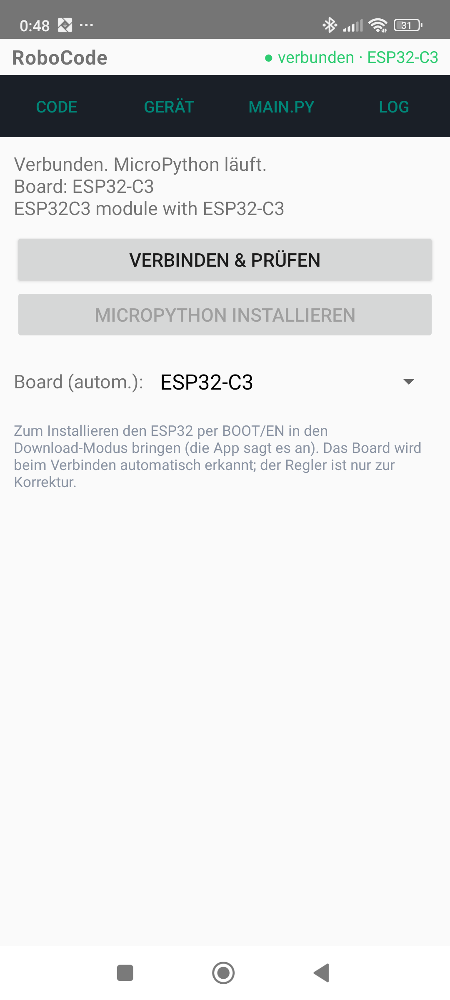
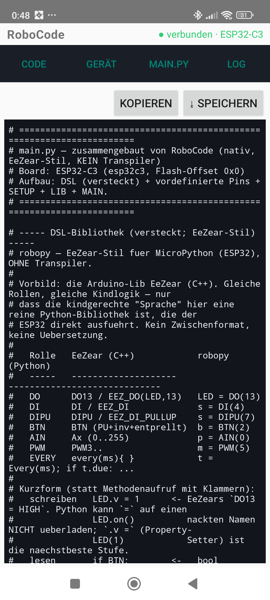
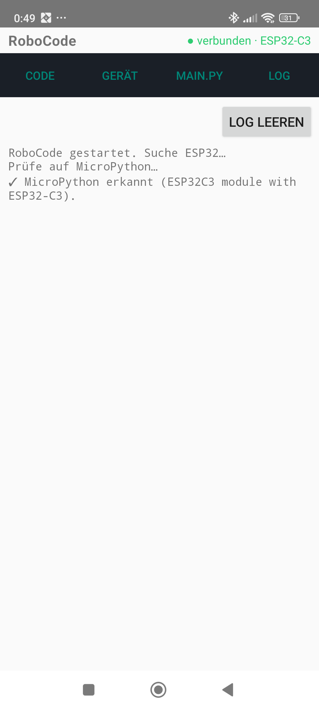

<!-- Erstellt 2026-11-10 auf Auftrag des Projektinhabers:
     „kannst du vom handy screenshots machen und in github readme einbinden?" -->

# RoboCode

Kindgerechte **MicroPython-IDE für den ESP32** — als native Android-App und als
Web-Playground. Man schreibt in drei Blöcken (SETUP · MAIN · LIB) einfaches,
EeZear-artiges Python, das zu **einer** `main.py` zusammengebaut und per USB-OTG
direkt auf den ESP32 übertragen und ausgeführt wird. **Kein Transpiler** — was
man schreibt, läuft so auf dem Gerät.

## Android-App

<table>
  <tr>
    <td align="center"><br><sub><b>Code</b> — SETUP/MAIN/LIB + Token-Tastatur</sub></td>
    <td align="center"><br><sub><b>Gerät</b> — verbinden, MicroPython installieren</sub></td>
    <td align="center"><br><sub><b>main.py</b> — die zusammengebaute Datei</sub></td>
    <td align="center"><br><sub><b>Log</b> — Ablauf &amp; ESP32-Ausgabe</sub></td>
  </tr>
</table>

Ablauf: Die App **sucht beim Start selbst** den ESP32. Ist keiner da, fordert sie
zum Anschließen auf; läuft noch kein MicroPython, bietet sie an, es zu **flashen**
(Firmware ist in der App eingebettet); sonst geht es direkt in die Code-Ansicht.
Das **Board wird automatisch erkannt** (aus `os.uname()` bzw. dem ROM-Chip), der
Verbindungsstatus steht in der Titelzeile.

## Die Sprache (DSL)

Basis sind **`DI` / `DO` / `AI` / `AO`** (digital/analog, ein/aus). Darüber liegen
vertraute Synonyme als Wrapper: **`LED` · `TASTER` · `MOTOR` · `RGB`** (WS2812).
Kurz und klammerarm dank Properties:

```python
# SETUP
led  = DO(8)        # Onboard-LED vieler ESP32-C3 an GPIO8
poti = AI(0)        # Analogeingang 0..255
rgb  = RGB(2)       # WS2812/NeoPixel

# MAIN — blinken, ohne Taster
while True:
    led.v = 1
    sleep_ms(500)
    led.v = 0
    sleep_ms(500)
```

Lese-Objekte verhalten sich im Ausdruck wie ihre Zahl — oft **ohne `.v`**:
`if taster:` · `if poti > 180:` · `dimmer.v = poti`. Jeder Board-Pin ist zudem als
`D<gpio>` / `A<gpio>` vordefiniert.

## Projektstruktur

| Pfad | Inhalt |
|------|--------|
| `src/` | Web-Playground (Vite + React + CodeMirror), Entwickler-/Testwerkzeug für die Sprache |
| `firmware/robopy.py` | die DSL-Bibliothek (EeZear-Stil); läuft auf MicroPython **und** als CPython-Simulation am PC |
| `android/` | native Android-App (Kotlin): Editor, Zusammenbau, USB-OTG-Flashen & -Übertragung |

Die DSL (`firmware/robopy.py`) wird von beiden Seiten geteilt (App-Kopie unter
`android/app/src/main/assets/dsl/`).

## Bauen

**Web-Playground**
```bash
npm install
./start.sh          # Vite-Dev-Server (http://localhost:5173)
```

**Android-App**
```bash
android/fetch-firmware.sh      # MicroPython-Bins (C3/S3) in die APK holen
# dann android/ in Android Studio öffnen und auf ein USB-OTG-Gerät installieren
```

## Status

Läuft auf echtem **ESP32-C3** (MicroPython v1.29.0): Erkennen, Installieren,
Übertragen und Ausführen funktionieren. Unterstützte Boards: ESP32-C3 und
ESP32-S3.
