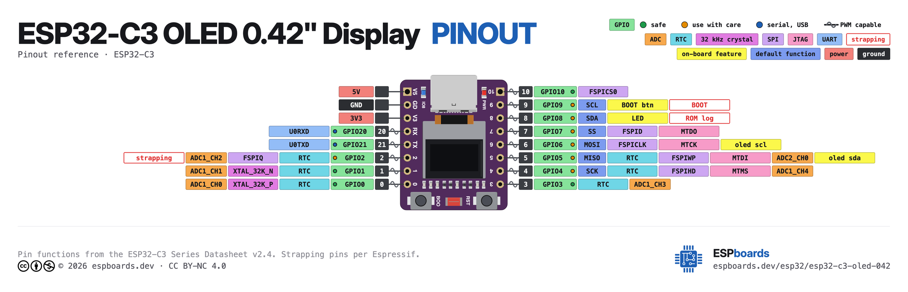
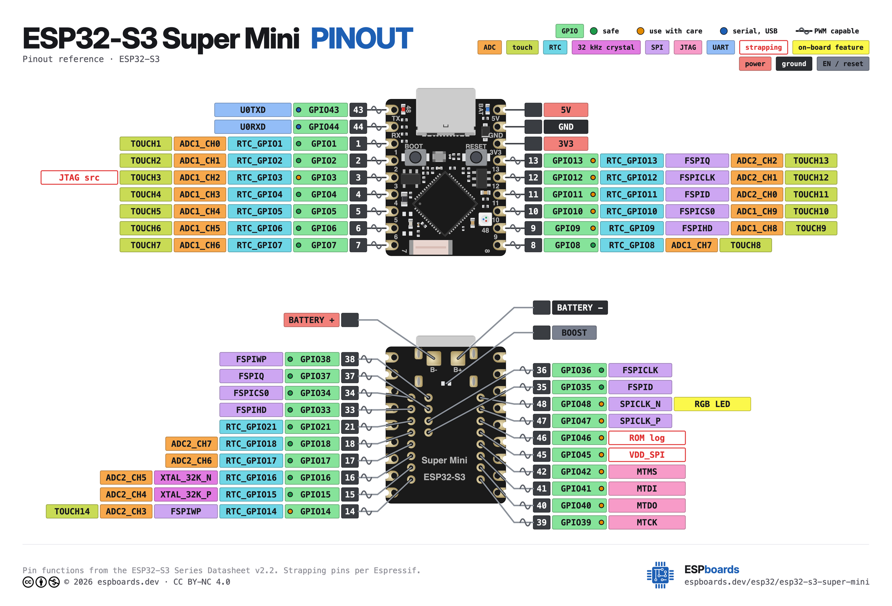

# Boards — Referenzen & Bilder

Zielplatinen für RoboCode (ESP32-SuperMini-Familie). Die Pin-Banken (DO/DI/A)
sind in `src/hw/boards.ts` und `android/app/src/main/java/de/robocode/Boards.kt`
definiert; die Bilder und externen Referenzen hier dienen als Nachschlagewerk
(u. a. für den geplanten Lern-Modus, siehe [`../ROADMAP.md`](../ROADMAP.md)).

Bilder und Referenz-Links beigesteuert von Valentin Heinitz (2026-11-11).

Die Pinout-Diagramme (`*-pinout.png`) stammen von **ESPboards**
(espboards.dev), lizenziert **CC BY-NC 4.0** — nur als Entwickler-Referenz
hier abgelegt, nicht in der ausgelieferten App (die zeigt die Foto-Platinen
aus `public/boards/`). Die physische Pin-Anordnung in der Board-Ansicht
(`Board.layout` in `src/hw/boards.ts`) folgt exakt diesen Diagrammen:
Platine von oben, USB-C oben.

## ESP32-C3 SuperMini

Pinout (ESPboards, CC BY-NC 4.0):

- RISC-V (Single-Core), WiFi + BLE, sehr kleiner Formfaktor
- Links (oben→unten): GPIO5,6,7,8,9,10,20,21 · Rechts: 5V,GND,3V3,GPIO4,3,2,1,0
- Referenz: <https://www.espboards.dev/esp32/esp32-c3-super-mini/>

## ESP32-C3 SuperMini OLED 0.42"

Pinout (ESPboards, CC BY-NC 4.0):

- Wie C3 SuperMini, zusätzlich **onboard-OLED 0.42"** (SSD1306, I²C) —
  passt direkt zum geplanten SSD1306-Treiber (ROADMAP §2)
- Onboard-OLED an **GPIO5 (SDA) / GPIO6 (SCL)**, onboard-LED an GPIO8
- Links (oben→unten): 5V,GND,3V3,GPIO20,21,2,1,0 · Rechts: GPIO10,9,8,7,6,5,4,3
- Referenz: <https://www.espboards.dev/esp32/esp32-c3-oled-042/>

## ESP32-S3 SuperMini

Pinout (ESPboards, CC BY-NC 4.0 — in der App nur die obere Ansicht genutzt):

- Xtensa LX7 (Dual-Core), WiFi + BLE, mehr GPIO als C3, onboard-RGB-LED (GPIO48)
- Obere Ansicht — Links (oben→unten): GPIO43,44,1,2,3,4,5,6,7 ·
  Rechts: 5V,GND,3V3,GPIO13,12,11,10,9,8
- Referenz: <https://www.espboards.dev/esp32/esp32-s3-super-mini/>
