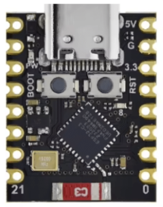
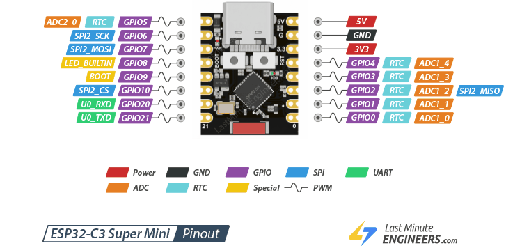
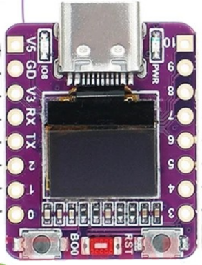
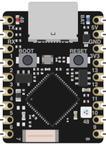

# Boards — Referenzen & Bilder

Zielplatinen für RoboCode (ESP32-SuperMini-Familie). Die Pin-Banken (DO/DI/A)
sind in `src/hw/boards.ts` und `android/app/src/main/java/de/robocode/Boards.kt`
definiert; die Bilder und externen Referenzen hier dienen als Nachschlagewerk
(u. a. für den geplanten Lern-Modus, siehe [`../ROADMAP.md`](../ROADMAP.md)).

Bilder und Referenz-Links beigesteuert von Valentin Heinitz (2026-11-11).

## ESP32-C3 SuperMini

Pinout:

- RISC-V (Single-Core), WiFi + BLE, sehr kleiner Formfaktor
- Referenz: <https://www.espboards.dev/esp32/esp32-c3-super-mini/>

## ESP32-C3 SuperMini OLED 0.42"

- Wie C3 SuperMini, zusätzlich **onboard-OLED 0.42"** (SSD1306, I²C) —
  passt direkt zum geplanten SSD1306-Treiber (ROADMAP §2)
- Referenz: <https://www.espboards.dev/esp32/esp32-c3-oled-042/>

## ESP32-S3 SuperMini

- Xtensa LX7 (Dual-Core), WiFi + BLE, mehr GPIO als C3, onboard-RGB-LED
- Referenz: <https://www.espboards.dev/esp32/esp32-s3-super-mini/>
